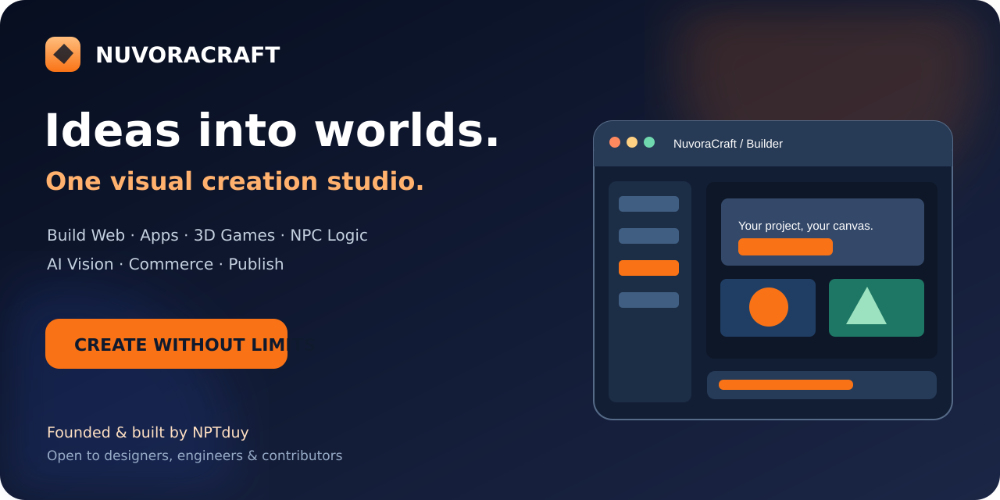

<div align="center">



# NuvoraCraft by NPTduy

**Build websites. Design apps. Create 3D worlds. Without switching tools.**

**By NPTduy** · Built in public · Community contributions welcome

[](https://github.com/duyuyd/no-code-builder-saas/actions/workflows/ci.yml)
[](https://nextjs.org)
[](https://react.dev)
[](https://typescriptlang.org)
[](./CONTRIBUTING.md)

**[Live Studio](https://no-code-builder-saas.vercel.app)** · **[45-second illustrated tour](./public/demo/nuvoracraft-product-tour.mp4)** · **[Contribute](./CONTRIBUTING.md)** · **[Roadmap](./docs/ROADMAP.md)**

</div>

---

### From an idea to a working project

NuvoraCraft is a visual, full-stack creation platform bringing web layout, interactive 3D scenes, time-based animation, safe NPC logic, collaborative editing and publishing into one workspace. **NPTduy** started the project to make advanced digital creation more accessible, whether you're a first-time maker, independent developer or game designer.

It is an actively developing product—not a claim of feature parity with Unity, FlutterFlow or Webflow.

### See it in motion

[▶ **Watch the 45-second original NuvoraCraft product tour (MP4)**](./public/demo/nuvoracraft-product-tour.mp4)

The video is an **illustrated feature overview**, not a recording of an authenticated production account. It presents visual editing, Screenshot to App, NPC logic, commerce, and community collaboration.

### What is built

| Workspace | Capabilities |
| --- | --- |
| 🎨 **Visual 2D Builder** | Recursive page nodes, drag-and-drop, mobile layout, autosave, undo/redo, JSX/HTML export |
| 🧊 **3D / WebXR** | Three.js + React Three Fiber scenes, materials, camera and browser-supported immersive preview |
| ⏱️ **Timeline** | Editable keyframes and animations with scene persistence |
| 🧠 **Nuvora Copilot** | Real `POST /api/chat` backed by the official OpenAI Node SDK; authenticated, quota-limited |
| 📸 **Screenshot to App** | Real image-to-`ui_tree` via `POST /api/vision` (`gpt-4o`) → editable Builder project |
| 🎮 **NPC Logic** | `POST /api/generate-logic` → validated state machine → deterministic JS; manual approval |
| 🛒 **Commerce** | Supabase catalog, product cards and checkout endpoint; payOS requires merchant activation |
| 🧩 **Marketplace & Plugins** | Creator listings, searchable templates, data-only plugins inside a worker; no arbitrary remote JS execution |
| 📱 **Mobile Runtime** | Browser preview QR; APK/IPA requires configured native build/signing infrastructure |
| 🤝 **Real-time collaboration** | Shared workspace changes and presence, subject to Supabase permissions |

**Reality check:** features requiring API keys, signing credentials, merchant accounts, paid plans or third-party deployment remain inactive until configured. A successful CI build does not prove all external integrations have processed a real transaction or generated a signed app. The project uses RLS for user-owned records and validates model-generated structures before persistence.

### Architecture

```text
Next.js 15 / React 19 / TypeScript / Tailwind 4
  ├─ Web Builder (dnd-kit + recursive UI tree + undo / redo)
  ├─ 3D Engine (React Three Fiber + Three.js + XR)
  ├─ AI Routes (OpenAI SDK on server ONLY)
  │    ├─ /api/chat              → gpt-4o-mini
  │    ├─ /api/vision            → gpt-4o / validated UI tree
  │    └─ /api/generate-logic   → gpt-4o-mini / NPC graph compiler
  ├─ Commerce + Marketplace (payOS, opt-in)
  ├─ Supabase Auth, PostgreSQL, RLS, Realtime, Storage
  └─ GitHub Actions + Vercel
```

### Run locally

Requires Node.js 22, a Supabase project and environment variables. The server uses an **environment-only OpenAI secret**—no key is ever embedded in the repository.

```bash
git clone https://github.com/duyuyd/no-code-builder-saas.git
cd no-code-builder-saas
npm install
cp .env.example .env.local
# Fill NEXT_PUBLIC_SUPABASE_URL and NEXT_PUBLIC_SUPABASE_ANON_KEY.
# Optional: OPENAI_API_KEY (server-only, then enable OpenAI in /admin/ai).
npm run dev
```

Apply `supabase/schema.sql` when provisioning a new database and review incremental migrations in `supabase/migrations/` for an existing deployment.

```bash
npm run typecheck
npm run build
npm run test:ai
npm run test:ecosystem
```

Do not commit `.env.local`, embed any secret in frontend code, or configure a fallback API key. Use Vercel encrypted Environment Variables and rotate exposed keys.

### Help build NuvoraCraft

We welcome thoughtful **first-time contributors, UI designers, TypeScript engineers, Three.js creators, technical writers and QA testers**. Fix accessibility, improve performance, document onboarding, refine the 3D canvas or propose a new workflow.

- Read **[CONTRIBUTING.md](./CONTRIBUTING.md)** to start a PR.
- Search **[Issues](https://github.com/duyuyd/no-code-builder-saas/issues)** for work or submit a specific improvement proposal.
- Read **[Roadmap](./docs/ROADMAP.md)** for prioritized modules.
- Report vulnerabilities privately using **[SECURITY.md](./SECURITY.md)**.
- Use the pull request template; small, testable changes are preferred.

**Start with an open task:**
- [#10 · Beginner-friendly bilingual onboarding](https://github.com/duyuyd/no-code-builder-saas/issues/10) — `good first issue`
- [#11 · OpenAI route integration tests](https://github.com/duyuyd/no-code-builder-saas/issues/11) — `help wanted`
- [#12 · Accessible visual Builder](https://github.com/duyuyd/no-code-builder-saas/issues/12) — `help wanted`

New to the codebase? A documentation correction or responsive UI improvement is a meaningful first contribution.

### Credits & identity

**NuvoraCraft is founded by NPTduy.** The project is not affiliated with OpenAI, Vercel, Unity, FlutterFlow or Webflow. Product capabilities come from maintained source code and authorized third-party services. All contributors are credited in git history and pull requests.

**Current source:** [github.com/duyuyd/no-code-builder-saas](https://github.com/duyuyd/no-code-builder-saas) · **Status:** active development

> Public repository does not automatically grant a software license. Project owners will select an explicit open-source license before external distribution rights are offered.

## GitHub Guardian — DevSecOps & real production audits

The project has security, supply-chain and live-site checks through GitHub Actions. The implementation and **measured** Lighthouse baseline are documented in [GitHub Guardian](docs/GITHUB_GUARDIAN.md). No workflow automatically merges, deploys, alters customer data or changes mobile signing keys.
